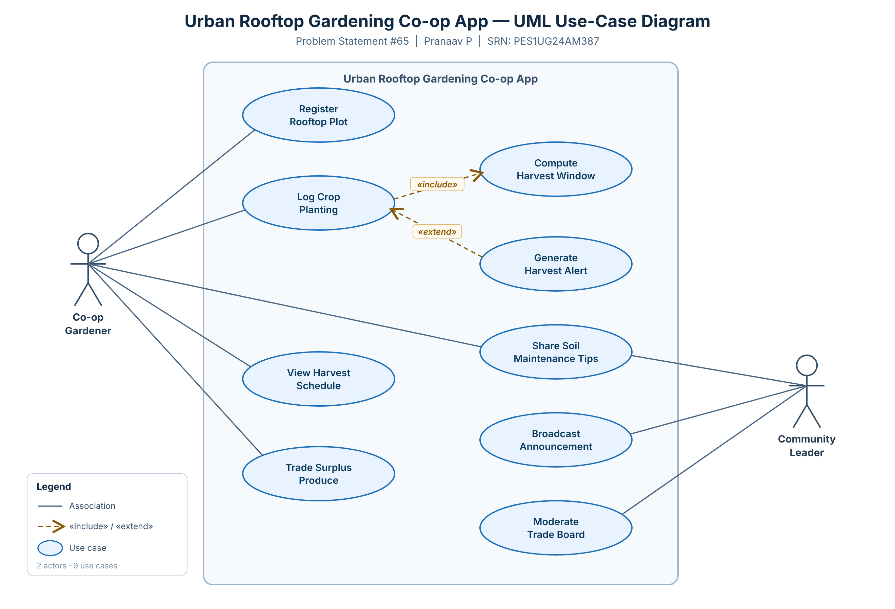

# Lab 1 — Requirements Engineering & UML Use-Case Modelling

**Scenario:** Urban Rooftop Gardening Co-op App (Problem Statement #65)
**Name:** Pranaav P &nbsp;•&nbsp; **SRN:** PES1UG24AM387

A community urban-agriculture app for registering rooftop plots, logging crop yields and harvest
schedules, sharing soil-maintenance tips, and trading surplus produce.
**Actors:** Co-op Gardener, Community Leader.

## Deliverable 1 — Requirements Table

Formal document: [`Lab1_Requirements_Table.docx`](Lab1_Requirements_Table.docx)

### Functional Requirements
| ID | Priority | Description | Acceptance Criteria | Rationale |
|----|----------|-------------|---------------------|-----------|
| **FR-001** | High | Allow a Co-op Gardener to log seasonal crop planting dates for a registered plot, and compute the estimated harvest window and expected yield weight from crop type and planting date. | *Pass:* harvest window/alert generated within the predicted window for a valid record. *Fail:* an invalid planting-date sequence (harvest-before-planting) is accepted. | Core value of the app — plan harvests and anticipate yields. |
| **FR-002** | High | Allow a Co-op Gardener to register a rooftop plot (location, area m², sunlight, owner) and assign each a unique Plot ID. | *Pass:* plot with all mandatory fields saved and retrievable by Plot ID. *Fail:* saved with a missing field or duplicate Plot ID. | Plots are the anchor entity for crop logs, yields and trades. |
| **FR-003** | Medium | Allow a gardener to post surplus produce (item, quantity, availability date) to a community trade board and let others reserve/claim listings. | *Pass:* posted listing visible to others and status → "Reserved" when claimed. *Fail:* a claimed listing stays available to others. | Reduces food waste; supports produce sharing. |
| **FR-004** | Medium | Allow members to publish and browse soil-maintenance tips, tagged by topic (composting, pH, pests), newest first. | *Pass:* published tip appears in its tagged feed within one refresh. *Fail:* a tip is published without a topic tag. | Builds shared community knowledge. |
| **FR-005** | Low | Allow a Community Leader to broadcast announcements to all members and moderate (hide/remove) rule-violating trade-board listings. | *Pass:* broadcast reaches all active members; moderated listing removed from the public board. *Fail:* a non-leader can broadcast or moderate. | Governance; keeps the shared boards trustworthy. |

### Non-Functional Requirements
| ID | Type | Priority | Description | Acceptance Criteria | Rationale |
|----|------|----------|-------------|---------------------|-----------|
| **NFR-001** | Performance & Security | High | The trade board updates surplus listings in near real-time (≤ 2 s) across members, over authenticated, encrypted (TLS) connections. | *Pass:* benchmarking confirms ≤ 2 s median update latency and TLS-only transport under simulated peak load (200 concurrent members). *Fail:* latency exceeded or any unencrypted update observed. | Freshness prevents double-claims; encryption protects member data. |
| **NFR-002** | Usability & Availability | Medium | The app is usable outdoors (WCAG 2.1 AA contrast, touch targets ≥ 44 px) and the backend keeps ≥ 99.5% monthly availability in the growing season. | *Pass:* accessibility audit shows no AA contrast failures and uptime ≥ 99.5%. *Fail:* AA failures found or uptime < 99.5%. | Used outdoors in bright light; reliability keeps logging/trading dependable. |

## Deliverable 2 — UML Use-Case Diagram

*Editable source:* [`use_case_diagram.svg`](use_case_diagram.svg) · *Submission image:* [`use_case_diagram.png`](use_case_diagram.png)

- **Actors:** Co-op Gardener, Community Leader
- **`«include»`:** *Log Crop Planting* includes *Compute Harvest Window* (the computation always runs).
- **`«extend»`:** *Generate Harvest Alert* extends *Log Crop Planting* (optional — only when alerts are enabled).

## Deliverable 3 — Use-Case Flow Specification

Formal document: [`Lab1_UseCase_Flow_Specification.docx`](Lab1_UseCase_Flow_Specification.docx) (1 page)

**Use case:** Log Crop Planting (UC-02) · **Primary actor:** Co-op Gardener

**Preconditions:** gardener is logged in; has at least one registered plot (FR-002); crop catalogue available.
**Postconditions:** planting record persisted; harvest window + yield computed and stored (`«include»`); harvest alert optionally scheduled (`«extend»`).

**Main Success Scenario**
1. Gardener selects a registered plot.
2. System displays the planting form and crop catalogue.
3. Gardener selects crop type and enters the planting date.
4. System validates the planting date (valid, not an impossible sequence).
5. System computes the harvest window and expected yield from growth duration and plot area — `«include» Compute Harvest Window`.
6. System saves the planting record with the computed window and yield estimate.
7. System confirms and displays the estimated harvest window.
   - 7a. `«extend» Generate Harvest Alert` — if alerts are enabled, schedule a harvest-window notification.

**Alternate Flow — A1: Invalid planting date sequence (at step 4)**
- 4a.1 System detects an invalid date (earlier than the plot's last harvest, or harvest-before-planting).
- 4a.2 System rejects the entry and shows a validation message.
- 4a.3 System prompts for a valid date and returns to step 3.
- 4a.4 If the gardener cancels, no record is saved (the invalid sequence is never accepted).
