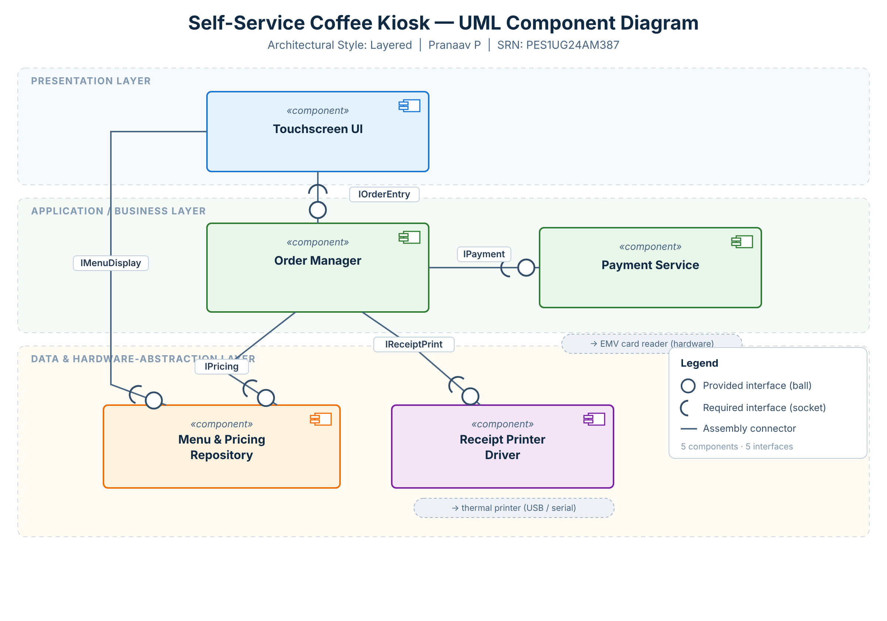

# Lab 3 — Component Modelling & Architectural Pattern Selection

**Scenario:** Self-Service Coffee Kiosk System
**Name:** Pranaav P &nbsp;•&nbsp; **SRN:** PES1UG24AM387

## Deliverable 1 — UML Component Diagram

*Editable source:* [`component_diagram.svg`](component_diagram.svg) · *Submission image:* [`component_diagram.png`](component_diagram.png)

### Components (5)
| # | Component | Layer | Responsibility |
|---|-----------|-------|----------------|
| 1 | **Touchscreen UI** | Presentation | Renders the menu, captures touch selections (coffee type, size), drives the ordering flow. |
| 2 | **Order Manager** *(given)* | Application / Business | Orchestrates an order: validates selections, requests pricing, calls payment, triggers the receipt. |
| 3 | **Payment Service** *(given)* | Application / Business | Processes the credit-card payment via the EMV reader and returns an authorisation result. |
| 4 | **Menu & Pricing Repository** | Data | Stores the 3 coffee types, 2 sizes and prices; serves menu and pricing queries. |
| 5 | **Receipt Printer Driver** | Hardware-Abstraction | Formats the order and drives the thermal receipt-printer hardware. |

### Interfaces (5 — ball = provided, socket = required)
| Interface | Provided by | Required by | Purpose / technology |
|-----------|-------------|-------------|----------------------|
| `IOrderEntry`   | Order Manager | Touchscreen UI | Submit customer selections (in-process API call) |
| `IMenuDisplay`  | Menu & Pricing Repository | Touchscreen UI | Fetch menu items to display (DB query) |
| `IPayment` *(given)* | Payment Service | Order Manager | Payment-processing requests (secure API) |
| `IPricing`      | Menu & Pricing Repository | Order Manager | Look up item prices / compute total (DB query) |
| `IReceiptPrint` | Receipt Printer Driver | Order Manager | Print the receipt (USB/serial hardware driver) |

External hardware: Payment Service → **EMV card reader**; Receipt Printer Driver → **thermal printer**.

## Deliverable 2 — Written Justification

Formal document: [`Lab3_Architecture_Justification.docx`](Lab3_Architecture_Justification.docx)

> **We chose a Layered (3-tier) Architecture for the Self-Service Coffee Kiosk System.**

**1. Architectural Choice.** Three horizontal layers, each depending only on the one beneath it:
Presentation (Touchscreen UI) → Application/Business (Order Manager, Payment Service) →
Data & Hardware-Abstraction (Menu & Pricing Repository, Receipt Printer Driver).

**2. Two Reasons.**
1. *Fit to a simple, fixed workflow* — the kiosk is one self-contained device with a small, stable feature set (3 coffee types × 2 sizes → pay → print). Layering maps these onto clear tiers and keeps the fixed workflow easy to build, test and maintain, without the operational and networking overhead a Microservices style would add to a single device.
2. *No need for distributed scaling* — one kiosk serves one customer at a time, so there is no demand for independent scaling or deployment. A layered monolith enforces separation of concerns while avoiding the single-remote-server bottleneck of pure Client-Server and the latency of service-to-service hops.

**3. Security Advantage.** Layering confines the Payment Service to the business tier behind the UI. The Touchscreen UI never handles raw card data or talks to the gateway directly — every payment request funnels through one controlled path (Order Manager → Payment Service → EMV reader). This single boundary shrinks the attack surface, centralises input validation / PCI-style controls, and keeps cardholder data out of the UI layer.

**4. Performance Benefit.** All layers run in-process on the kiosk, so inter-layer calls are fast local method invocations rather than network round-trips — giving the low, predictable latency a touchscreen needs. Menu and pricing data can be cached in the data tier so the menu renders instantly, even during busy periods.
