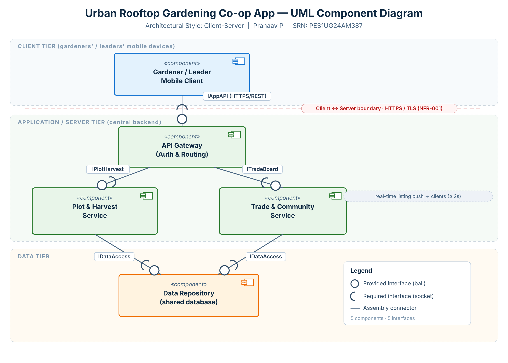

# Lab 3 — Component Modelling & Architectural Pattern Selection

**Scenario / Topic:** Urban Rooftop Gardening Co-op App (Problem Statement #65)
**Name:** Pranaav P &nbsp;•&nbsp; **SRN:** PES1UG24AM387

> Lab 3's generic handout used a coffee-kiosk example; this deliverable applies the same Lab 3
> tasks (component diagram + architecture justification) to **our actual topic**, the Urban
> Rooftop Gardening Co-op App — the same system modelled in Lab 1.

## Deliverable 1 — UML Component Diagram

*Editable source:* [`component_diagram.svg`](component_diagram.svg) · *Submission image:* [`component_diagram.png`](component_diagram.png)

### Components (5)
| # | Component | Tier | Responsibility |
|---|-----------|------|----------------|
| 1 | **Gardener / Leader Mobile Client** | Client | Thin mobile UI — register plots, log planting, view harvest schedule, trade, tips. |
| 2 | **API Gateway (Auth & Routing)** | Server | Single entry point; authenticates users and routes requests to the services. |
| 3 | **Plot & Harvest Service** | Server | Plot registration, crop logging, harvest-window & yield computation (FR-001, FR-002). |
| 4 | **Trade & Community Service** | Server | Real-time trade board, soil-maintenance tips, leader broadcasts/moderation (FR-003–FR-005). |
| 5 | **Data Repository** | Data | One shared database for plots, crops, listings, tips and users. |

### Interfaces (5 — ball = provided, socket = required)
| Interface | Provided by | Required by | Purpose / technology |
|-----------|-------------|-------------|----------------------|
| `IAppAPI`      | API Gateway | Mobile Client | All app requests + real-time subscription (HTTPS / REST, TLS) |
| `IPlotHarvest` | Plot & Harvest Service | API Gateway | Plot/crop/harvest operations (internal API) |
| `ITradeBoard`  | Trade & Community Service | API Gateway | Trade board, tips, broadcasts (internal API) |
| `IDataAccess`  | Data Repository | Plot & Harvest Service | Persist/query plot & crop data (DB query) |
| `IDataAccess`  | Data Repository | Trade & Community Service | Persist/query listings & tips (DB query) |

The **client ↔ server boundary is secured with HTTPS/TLS** (NFR-001), and the Trade & Community
Service pushes trade-board updates to clients within the ≤ 2 s freshness target.

## Deliverable 2 — Written Justification

Formal document: [`Lab3_Architecture_Justification.docx`](Lab3_Architecture_Justification.docx)

> **We chose a Client-Server Architecture for the Urban Rooftop Gardening Co-op App.**

**1. Architectural Choice.** Thin mobile clients communicate over HTTPS with a central backend
(API Gateway → Plot & Harvest / Trade & Community services), backed by one shared Data Repository.
(The server is still internally layered: API → business services → data access.)

**2. Two Reasons.**
1. *Shared, consistent data for many users* — many gardeners and leaders on their own phones must act on the same plots, listings and tips. A central server with thin clients gives one authoritative source, essential for the trade board (two gardeners must not both claim the same produce). A single-device Layered app can't share data across users; full Microservices is disproportionate for a community app.
2. *Centralised control & real-time updates* — the Community Leader broadcasts and moderates from one place (FR-005), and the server pushes trade-board changes to every client to meet NFR-001's ≤ 2 s target.

**3. Security Advantage.** All data and transactions flow through one hardened backend over authenticated, encrypted (TLS) connections. Auth and role-based authorization are enforced centrally at the API Gateway (e.g. only leaders moderate), so security policy sits in one auditable place and sensitive data never lives permanently on the clients.

**4. Performance Benefit.** The server maintains push channels (WebSockets/subscriptions) for ≤ 2 s trade-board updates and caches/indexes hot data server-side; thin clients stay responsive outdoors (NFR-002). The single-server availability risk is mitigated by replicating and load-balancing the server tier.

### Architectural style comparison
| Style | Verdict | Why |
|-------|---------|-----|
| **Client-Server** | ✅ Chosen | One consistent shared data source, central auth/moderation, real-time fan-out — natural fit for a multi-user app. |
| Microservices | ❌ Rejected | Independent scaling, but operational complexity, latency and data-consistency challenges are disproportionate here. |
| Layered | ❌ Rejected | Good for a single app's internal structure, but cannot by itself share data across many users' devices. |
